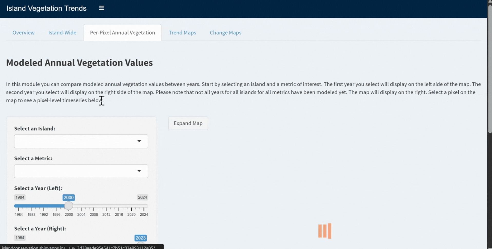

### **Island Vital Signs**

Current version: v1.0.0

Try the app here: 🔗 [Island Vital Signs](https://islandconservation.shinyapps.io/island-vital-signs/)

## Overview

Island Vital Signs is a decision support tool for island managers to visualize long-term trends, generate standardized reports of vegetation change, assess and monitor vegetative trends, and identify areas to prioritize for future interventions. This tool helps identify and prioritize areas for future conservation where active restoration may be required, guide intra-island reintroduction site selection on predator-free islands, and optimize in situ monitoring to measure change in places most likely to experience impact after invasive mammal removal.

## Modeling Results Module Descriptions

0.  **Overview** -- An overview of the app's modules, key terms, etc.
1.  **Island-Wide (Concept, not yet available)** -- Island-wide summaries and trend results. Users select an island and a metric of choice to explore. Global predicted trends, global total accumulated change, global total annualized change, global timeseries, and a summary table are returned.
2.  **Per-Pixel Annual Vegetation** -- Spatially explicit annual model predictions. Users select an island and metric of choice to explore in addition to two years to compare. Raster maps of model predictions are returned for the years selected on the left and right side of a leaflet window. Pixels are selectable, and pixel-level time series plots are rendered below.
3.  **Change Maps** -- Spatially explicit model change results. Users select an island, metric, change type (accumulated/annualized), time period, and probability level of choice to explore. Raster maps of model change are returned, with the left side of the leaflet window displaying all modeled pixels, and the right side displaying only significant pixels at the selected probability level. Pixels are selectable, and pixel-level time series plots are rendered below.

## Demo



## File Structure

```         
├── global.R           # Main global Shiny app script 
├── ui.R               # Main ui Shiny app script 
├── server.R           # Main server Shiny app script 
├── R/                 # Functions
├── data-prep/         # Pre-development scripts for prepping data & metadata
├── www/               # Static assets 
├── images/            # Readme images
├── data/              # Input datasets -- not included on GitHub
├── renv/              # Environment
├── renv.lock          # Environment
├── scratch/           # Brainstorming scripts
├── README.md          # This file
```

## Data Management

Data are managed following steps in the data-prep folder. data-prep/README-data-prep.md contains step by step instructions for following scripts to prepare metadata and data for the application. Currently the application is hosted under a Basic Plan on ShinyApps.io.
